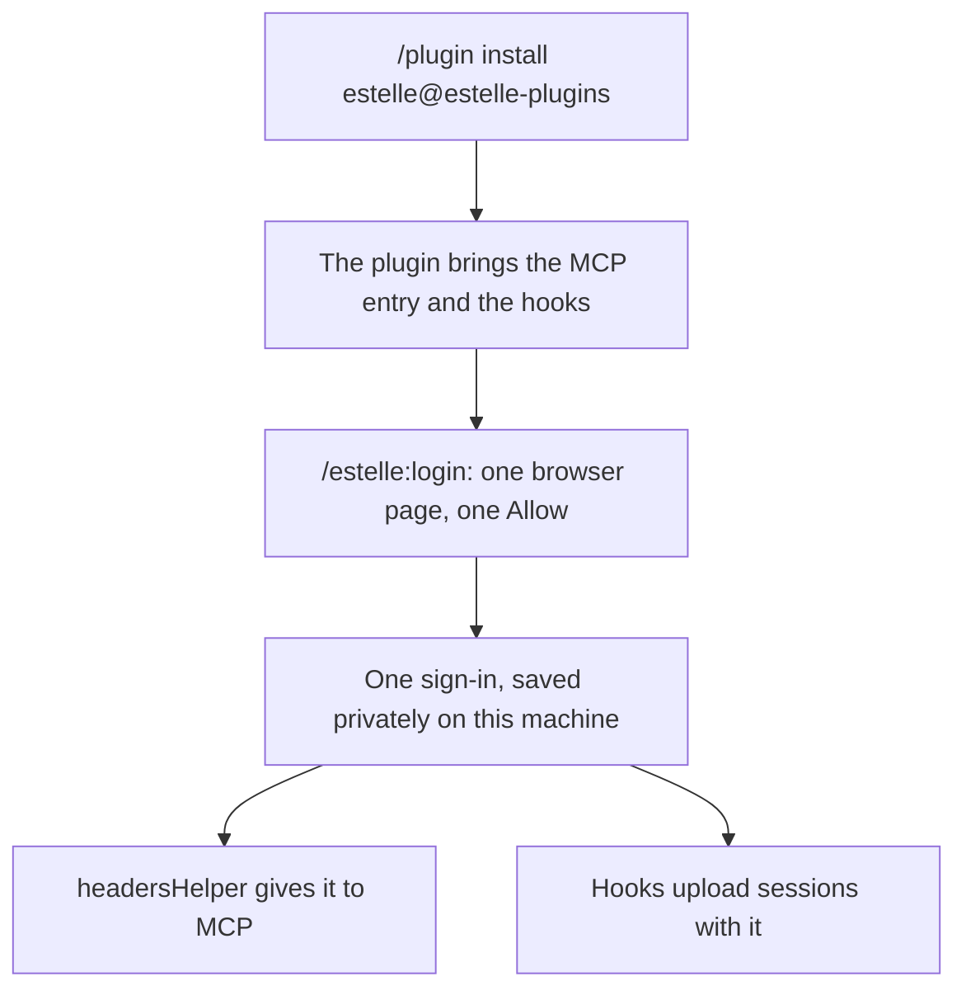

# One sign-in for tools and session recording

Install the plugin and sign in once. In Claude Code that is `/estelle:login`, which opens one browser page with one Allow. That one sign-in connects Estelle's tools and records your sessions. You do not create a key and you do not sign in twice.

## How it fits together

The plugin carries the MCP entry, so nobody installs the MCP server separately. Hooks are separate programs and cannot read a sign-in made through `/mcp`, because Claude Code does not expose that token to them. So the plugin makes its own sign-in and gives it to both.

## What stays the same

- **If you signed in through `/mcp`:** your tools keep working. When the plugin has no sign-in of its own, it gives Claude Code no header and Claude Code uses its own OAuth. Each new session tells you sessions are not being recorded and to run `/estelle:login`.
- **If `ESTELLE_API_KEY` is set:** hooks use the key as before, the plugin's sign-in is not opened, and MCP is unchanged.

## What the grant allows

The page says what you are approving. This token works in two places: Estelle's MCP server, where it acts as your account, including starting work that spends, and session upload, which sends your messages, tool results and captured file changes. Hooks use it for upload only.

It is stored under `~/.estelle-plugins/capture-auth` with owner-only permissions, not in your keychain. Sign out with `/estelle:logout`. That revokes this plugin's grant for your account, so another machine signed in with the plugin has to sign in again. Your Claude and ChatGPT connections are not touched, and sessions already recorded stay in the account.

## When it stops

The token refreshes about hourly.

- **Offline, or the server is busy or down:** nothing is lost. The sign-in stays good and the next hook tries again.
- **A lost reply, or a hook killed mid-refresh:** the plugin cannot tell whether the old token was spent, and sending it twice would end the sign-in on every machine. So recording stops.
- **When recording has stopped:** the session says so once, at the first point that host can show text, with the fix. Tools fall back to Claude Code's own OAuth if you have it. `/estelle:login` replaces the stopped sign-in after you approve again.

A lock left by a dead process clears after 11 minutes, longer than any real sign-in can hold it.

## Limits

- **Only Claude Code gets the one-step flow.** Other hosts have no documented way for a plugin to supply the MCP header, so they still use `ESTELLE_API_KEY` for tools. The same login records sessions there.
- **Windows** is not supported yet, and the command says so.
- **A machine with no browser:** the command prints the address, but the sign-in returns to this machine's loopback address, so a browser elsewhere cannot finish it. Use a key.
- **After signing in, tools may not connect until you reconnect.** Run `/mcp` and reconnect Estelle, or restart.
- **An old sign-in that was replaced is not revoked.** It expires by itself within 30 days. Revoke is per account and would also end the new one.
- **Queued uploads from a replaced sign-in** stay on disk and are not sent. A session that fires again re-uploads from its start, under whichever account is signed in by then.
- **A session that ended while recording was stopped** and never resumes is not recorded.
- **Replacing a sign-in needs the file to be readable.** If `~/.estelle-plugins` was given wider permissions by hand, login refuses until they are fixed, and it says `capture_private`.
